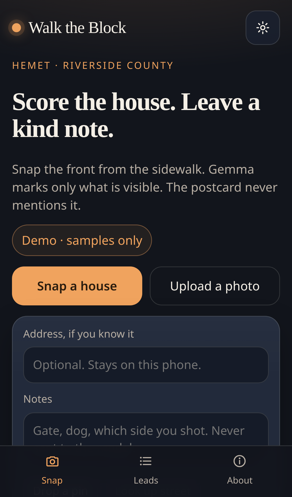
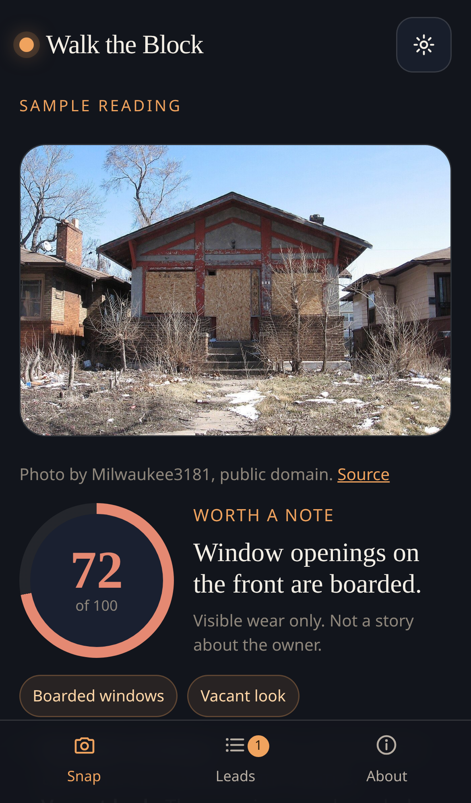
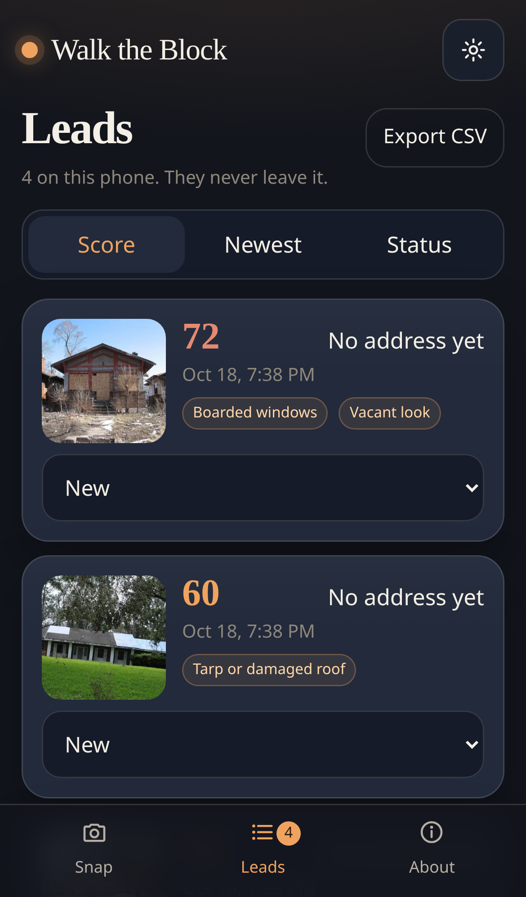

# Walk the Block

A phone-first field tool for **drive for dollars**. You snap the front of a house. An open-weight Gemma model marks only the distress you can see, scores it from 0 to 100, and the app drafts a kind postcard that does not mention any of it. The lead list stays on the device.

Built for Cassandra, a wholesaling researcher in Hemet, Riverside County. Wholesalers and small investors are the people who would pay, about **$19 a month**, for a privacy-first alternative to cloud driving-for-dollars apps. The list of houses is the business. It should not have to live in someone else's database.

This repository was **started on October 18, 2026**, inside the [DEV Hacktoberfest Week 2 "Side Hustle"](https://dev.to/challenges/hacktoberfest-week2-2026-10-12) window, and finished the same day. Later commits, if any, will be noted here.

## What you can do

1. Snap or upload a photo. Address, notes, and a GPS pin are optional.
2. Gemma returns structured JSON: a distress score, the visible signals it actually sees, a confidence note, and a one-line reason. It is instructed not to guess about the owner's life.
3. Read or copy a postcard in English or Spanish. The standard note is a fixed, respectful script (no false urgency, no hint that the owner is in trouble). A model draft is used only if it passes the same check.
4. Keep every lead in IndexedDB on the phone: photo, signals, address, and a status (new, letter sent, follow up, dead). Sort the list and export CSV.

Signals the model is allowed to mark: tarp or damaged roof, overgrown yard, boarded windows, peeling paint, piled mail or notices, junk or debris, broken fence, vacant look.

## Try it with no key

Demo mode is the default. Four public-domain or CC0 house photos are built in, with hand-labeled readings, so a judge can walk the whole flow without an API key. Those readings are **not** live model output. Credits are in the app (About) and in [`public/samples/CREDITS.md`](public/samples/CREDITS.md).

Your own photos are refused in Demo mode. They are not uploaded and not saved.

## Screenshots







## Run it locally

```bash
npm install
npm test
npm run dev
```

Open [http://localhost:5173/](http://localhost:5173/). The Vite base path defaults to `/`, which is also what Cloudflare serves. Set `VITE_BASE` if you ever need a subpath build.

```bash
npm run build
npm run preview
```

## Private mode (Ollama)

Vision-capable local default: **`gemma3:4b`**. Also valid: `gemma3:12b`, `gemma3:27b`. `gemma3:1b` and `gemma3:270m` are text-only and the app will warn you. `gemma4:e4b` is a newer vision option if you already have it.

Gemma 3 vision is several gigabytes. Running it inside the phone's browser would mean a huge download at the curb, so this app does not do that. The private path is Ollama on a machine you control, often the laptop in the car.

```bash
# https://ollama.com  — needs Ollama 0.6 or newer for Gemma 3
ollama pull gemma3:4b
ollama serve
```

In the app: Settings → Private → address `http://127.0.0.1:11434` → model `gemma3:4b` → Test Ollama.

To use your phone on the same Wi-Fi:

```bash
OLLAMA_HOST=0.0.0.0:11434 OLLAMA_ORIGINS=* ollama serve
npm run dev -- --host
```

On the phone, open `http://<laptop-ip>:5173/` and set the Ollama address to `http://<laptop-ip>:11434`.

iPhone Safari blocks an `http://` Ollama call from an `https://` page. Run the app itself over http on the LAN, as above. Do not forward port 11434 to the public internet. The request contains the photo and the scoring prompt only. Address, notes, and the GPS pin stay in the browser.

One optional exception: **Look up street** sends the GPS pin (only the pin) to OpenStreetMap's Nominatim service to fill in a street name. Skip that button and the pin never leaves the phone.

## AI Studio

Hosted vision default: **`gemma-4-31b-it`** (Gemma 4, image input documented by Google). Also listed in Settings: `gemma-4-26b-a4b-it`. Google's [Gemma on the Gemini API](https://ai.google.dev/gemma/docs/core/gemma_on_gemini_api) page lists these two Gemma 4 ids, and Gemma 4 accepts images. Gemma 3 is still the default for Ollama.

1. Create a key in [Google AI Studio](https://aistudio.google.com/apikey).
2. Settings → AI Studio → paste the key. It is stored in `localStorage` under `wtb-aistudio-key` and sent only as the `x-goog-api-key` header.
3. Test key. That check is text-only. A house photo is the vision check.

This mode sends the photo to Google. It does not send the address, notes, or pin. There is no key in this repository.

If a photo comes back cut off or unreadable, try again or switch between `gemma-4-31b-it` and `gemma-4-26b-a4b-it`. Gemma does not use a separate system role here. The instructions are the first user turn, and the reply is parsed even when it is wrapped in prose or a code fence.

## Deploy (Cloudflare Workers)

The site is static. [wrangler.jsonc](wrangler.jsonc) publishes the Vite `dist` folder as Workers static assets, with single-page fallback, under the worker name `walk-the-block`. There is no GitHub Pages workflow.

From Windows PowerShell, with `CLOUDFLARE_API_TOKEN` already set in the environment (the same token used for other Workers). Wrangler reads that variable. This does not run `wrangler login` and does not open a browser.

```powershell
npm.cmd install
npm.cmd run cf:deploy
```

`cf:deploy` typechecks, runs `vite build --base /`, then `wrangler deploy`. The account id in `wrangler.jsonc` is the same Cloudflare account as MERA, so deploy does not ask you to pick an account.

When it finishes, the app is at [https://walk-the-block.casmazariegos.workers.dev](https://walk-the-block.casmazariegos.workers.dev).

## Tests, and what was not run live

`npm test` covers JSON parsing (fences, trailing commas, string scores, missing fields), the compliance filter on the postcard, CSV escaping, the request bodies (photo and prompt only), and the four sample files.

A live call is included as `src/live.test.ts`. It runs only when `GEMINI_API_KEY` or `GOOGLE_API_KEY` is set:

```bash
GEMINI_API_KEY=your-key npm test
```

**No key was available while this project was built**, so that test was skipped and the prompt was not executed against a live Gemma. Ollama was not running here either, so the private HTTP call was not live-tested. The parsers and request builders were.

## License

[MIT](LICENSE). Sample photos keep the licenses named in [`public/samples/CREDITS.md`](public/samples/CREDITS.md).
